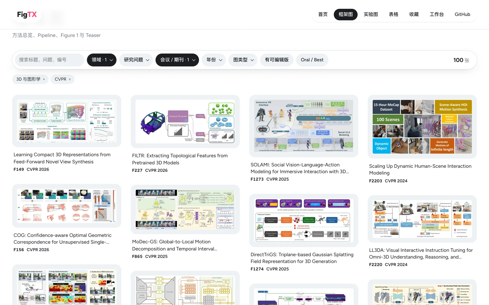
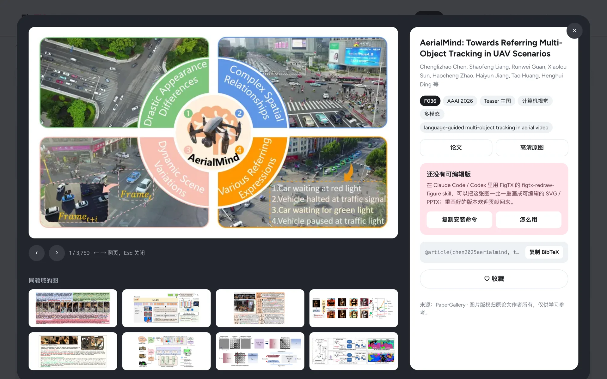
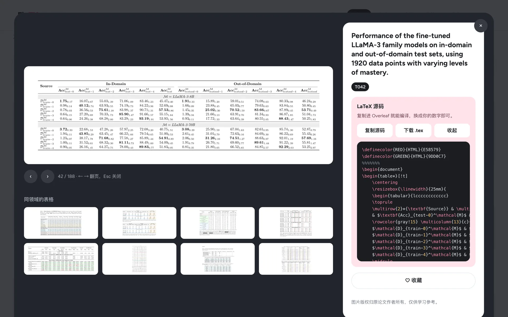

<p align="center"></p>

<h3 align="center">顶会顶刊的图和表，拿来就能改</h3>

<p align="center">
  按领域和研究问题浏览 <b>3,700+</b> 张顶会论文的框架图与主图、实验图和 LaTeX 表格；<br>
  表格和实验图直接复制源码，框架图一比一重画成可编辑的 SVG / PPTX。
</p>

<p align="center">
  <a href="https://zhipingwoods.github.io/FigTX/"></a>
  <a href="#在-claude-code--codex-里用-figtx"></a>
  <a href="https://github.com/ZhipingWoods/FigTX/releases"></a>
</p>

<p align="center"><a href="https://zhipingwoods.github.io/FigTX/"></a></p>

<p align="center">
  <b>3,759</b> 张框架图与主图 &nbsp;·&nbsp; <b>44</b> 张实验图 &nbsp;·&nbsp; <b>188</b> 个 LaTeX 表格 &nbsp;·&nbsp; <b>16</b> 个领域 &nbsp;·&nbsp; 每周自动同步
</p>

---

## 它能做什么

<table>
<tr>
<td width="33%" valign="top">

### 👀 看图
按 **领域**（计算机视觉、NLP 与 LLM、3D、机器人……）、**研究问题**、会议、年份、图类型筛选，瀑布流浏览。
每张图都标注论文、作者、会议和链接，带 BibTeX。

</td>
<td width="33%" valign="top">

### 📋 拿走源码
**188 个 LaTeX 表格**都附真实编译的预览和完整源码，复制进 Overleaf 就能编译；
**实验图**附可运行的 matplotlib 脚本，换数据就出图。

</td>
<td width="33%" valign="top">

### ✏️ 一比一重画
看中一张框架图？用 FigTX 的 skill 在 Claude Code / Codex 里**一比一重画**成可编辑的 SVG + PPTX，位置、线条、文字逐像素对齐原图。

</td>
</tr>
</table>

<p align="center"></p>
<p align="center"><sub>图库：筛选条件都写在链接里，可以直接分享一个筛好的视图</sub></p>

<table>
<tr>
<td width="50%"></td>
<td width="50%"></td>
</tr>
<tr>
<td align="center"><sub>框架图详情：论文信息、高清原图、BibTeX，以及重画成可编辑版的指引</sub></td>
<td align="center"><sub>表格详情：真实编译的预览 + 完整 LaTeX，复制或下载 .tex</sub></td>
</tr>
</table>

- **稳定编号直达**：每个条目有固定编号（表格 `T001…`、图 `F001…`），打开 `…/FigTX/#T042` 直接定位；编号一旦分配永不改变。
- **收藏**：点 ♡ 收藏，加备注，存在本机浏览器里，不需要登录；可以导出 / 导入换电脑。
- **离线可用**：桌面版和离线压缩包双击就能打开，不需要联网。

---

## 在 Claude Code / Codex 里用 FigTX

FigTX 提供 5 个 skill 和命令行工具 `figtx`。装好后直接用自然语言说要做什么：

| skill | 做什么 | 你可以这样说 |
|---|---|---|
| `figtx-find-figure` | 按领域、研究问题在图库里找参考图 | 「找几张扩散模型视频生成的框架图」 |
| `figtx-redraw-figure` | 把一张论文图**一比一**复刻成可编辑的 SVG + PPTX（照片类元素抠出后原位放回） | 「把这张图重画成可编辑的 PPT」 |
| `figtx-framework-figure` | 沿用参考图的版式和配色，画**你自己方法**的框架图 | 「照这张图的风格画我的方法总览」 |
| `figtx-table-from-screenshot` | 表格截图 → LaTeX，编译后逐格核对 | 「把这个表格截图转成 latex」 |
| `figtx-plot` | 实验图：套用论文风格出图，或复刻一张实验图截图 | 「用这个风格画我的消融实验柱状图」 |

```bash
uv tool install "git+https://github.com/ZhipingWoods/FigTX#subdirectory=packages/figtx-forge"
```

```bash
figtx skills install
```

第二条命令把 skill 装到 `~/.claude/skills` 和 `~/.codex/skills`，重启 Claude Code / Codex 生效（需要 [uv](https://docs.astral.sh/uv/)；表格转换还需要 `brew install tectonic`）。clone 了本仓库的话也可以 `npm run skills:install`（符号链接，仓库更新后立即生效）。

**一比一的合格标准**：`figtx redraw-check` 把渲染结果和原图逐像素比对——综合分数与深色笔画召回率 ≥ 0.98，局部召回率与边缘 F1 ≥ 0.97，颜色相似度 ≥ 0.98，文字完全一致，抠图面积 ≤ 40%。达不到就明确标为「需检查」。`figtx` 本身不调用任何模型、不读任何 API key；看图和写图由你用的 agent 完成。

---

## 快速开始

| 方式 | 怎么用 |
|---|---|
| **网页版** | 打开 **https://zhipingwoods.github.io/FigTX/**，无需安装 |
| **桌面版** | 到 [Releases](https://github.com/ZhipingWoods/FigTX/releases) 下载 macOS `.dmg` / Windows `.exe` / Linux `.AppImage`，离线可用 |
| **离线压缩包** | Releases 里的 `FigTX-offline-web.zip`，解压后双击 `index.html`（内网、U 盘都能用） |
| **本地开发** | 见下 |

```bash
git clone git@github.com:ZhipingWoods/FigTX.git && cd FigTX && npm install
```

```bash
npm run dev
```

其他常用命令：`npm run build`（构建网页）、`npm run electron:dev`（桌面窗口）、`npm run offline`（离线压缩包）、`npm run dist:mac | dist:win | dist:linux`（桌面安装包，建议用 [release workflow](.github/workflows/release.yml) 在三个平台的 runner 上打包）。

---

## 图库从哪来、怎么更新

图库由两个优秀的开源项目汇集而来，合并去重后统一编号、打上领域与研究问题标签：

| 来源 | 内容 |
|---|---|
| [topconf-paper-figure-gallery](https://github.com/qwdwqfwq/topconf-paper-figure-gallery) | ICLR / ICML / NeurIPS / CVPR / ACL / AAAI 2023–2026 论文的 Figure 1 与 Teaser |
| [PaperGallery](https://github.com/LongHZ140516/PaperGallery) | 框架图（pipeline）与主图（header），含代码与项目页链接 |
| FigTX 自有 | 188 个重新编译的 LaTeX 表格、实验图与 10 张论文图复刻 |

```bash
npm run sync
```

一条命令完成：拉取上游 → 合并去重（arXiv id 或标题识别同一篇论文，图片指纹识别同一张图）→ 生成缩略图 → 领域打标 → 原图上传到 Hugging Face 数据集 [OliverThompson/figtx-assets](https://huggingface.co/datasets/OliverThompson/figtx-assets) → 增量编号。可以重复运行，没有变化时不改动任何文件。

- **每周自动同步**：GitHub Action 每周一同步一次并开 PR，审核后合并。
- **上游删除不丢条目**：上游删掉的图会保留并标记，不会自动删除。
- **下架**：版权方要求移除时写进 `data/takedown.json`，条目、缩略图和高清原图会一并删除，之后同步也不会再加回。详见 [图片政策](IMAGES_POLICY.md)。
- **期刊图**：Nature / Science / Cell 等期刊的图按 [`data/journals.json`](data/journals.json) 的格式手工整理后，同样走 `npm run sync`。

<details>
<summary>LaTeX 表格与实验图的构建脚本</summary>

| 脚本 | 作用 |
|---|---|
| `tools/extract_docx.py` | docx → LaTeX，识别表格 / 图、抽取配色 |
| `tools/render_tex.py` | tectonic 编译 + 自动修复残缺片段 + 转 WebP |
| `tools/figlab/` | 实验图模板与论文图复刻（matplotlib / TikZ） |
| `tools/build-data.mjs` | 汇总全部条目，生成前端索引和按需加载的详情分片 |
| `tools/assign_numbers.py` | 增量分配稳定编号 |

</details>

<details>
<summary>论文图复刻：10 张代表性论文图逐项对齐（附可运行代码与可编辑矢量文件）</summary>

| 图 | 复刻结果 |
|---|---|
| **效率 · 显存分解** |  |
| **权衡 · 精度曲线** |  |
| **架构 · 流程与模块放大** |  |
| **结果 · 分组柱 + 热图** |  |

05、06 两张额外提供 `.svg` / `.pptx`（原生形状）/ `.pdf` 可编辑文件，见 `docs/assets/replicas/edit/`。

</details>

---

## 项目结构

```
src/                 网页与桌面版前端（React + Vite）：首页、图库、灯箱详情、收藏、工作台
packages/figtx-forge figtx 命令行工具与 5 个 skill（渲染、比对、导出 SVG/PPTX、编译表格、检索）
tools/sync/          图库同步：上游适配器、合并去重、缩略图、打标、HF 上传、每周 PR
tools/figgen/        本地框架图生成服务（工作台使用）
data/                条目元数据、编号、领域标签、同步来源（全部是文本，可审阅）
public/thumbs/       图库缩略图；高清原图在 Hugging Face
electron/            桌面版外壳
```

## 贡献

欢迎提交：新的论文图与表格、重画好的可编辑版（SVG / PPTX）、截图转好的 LaTeX、领域标签修正。重画结果可以先用 `figtx redraw-check` 自查是否达到一比一标准。贡献指南见 [docs/wiki/贡献指南.md](docs/wiki/贡献指南.md)。

## 致谢与版权

感谢 [topconf-paper-figure-gallery](https://github.com/qwdwqfwq/topconf-paper-figure-gallery)、[PaperGallery](https://github.com/LongHZ140516/PaperGallery) 汇集的论文图，[AutoFigure](https://github.com/ResearAI/AutoFigure) 的生成-评审-修改机制，以及 [paper-plot-skills](https://github.com/Trae1ounG/paper-plot-skills) 的实验图风格。

图库中的论文图版权归原论文作者与出版方所有，仅用于学习与研究参考，来源、署名与下架方式见 [IMAGES_POLICY.md](IMAGES_POLICY.md)。代码以 [Apache-2.0](LICENSE) 发布。
