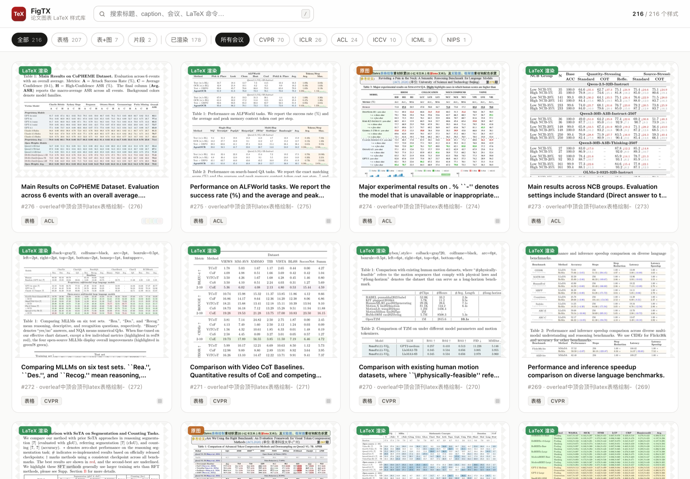

<div align="center">

# FigTX

**论文表格与图 · LaTeX / 绘图样式库**

[](https://zhipingwoods.github.io/FigTX/)
[](https://github.com/ZhipingWoods/FigTX/releases)
[](LICENSE)

macOS · Windows · Linux · Web

</div>

---

## 这是什么

写论文时最耗时的不是想清楚结果，而是把表调到"能看"、把图调到"能投"。
三线表、分组表头、加粗最优值、误差棒、断轴、内嵌放大图……每种都要试半天。

**FigTX 把这些一次收集齐，并且严格分成两类：**

| 分区 | 数量 | 内容 |
|---|---|---|
| **表格** | 216 | 顶会顶刊论文的 LaTeX 表格源码，用 `tectonic` 重编译出真实渲染图 |
| **图** | 60 | 框架图 12 · 动机图 6 · 实验定量 10 · 实验定性 8 · 绘图样式 24 |

每个条目都带：**真实渲染预览 · 完整源码 · 配色板 · 元信息**，一键复制。



## 两个分区

### 表格（LaTeX）

来自公开论文的表格代码，覆盖三线表、跨列表头、分组底色、最优值高亮、跨行合并、
整页宽表等常见做法。源码直接可粘，配色用 `\definecolor` 定义好一起带走。

### 图（框架 / 动机 / 实验 / 样式）

**样式**（16 种，来自 [SciencePlots](https://github.com/garrettj403/SciencePlots)）：
`science` / `science+ieee` / `science+nature` / 网格 / Notebook / 散点 / 无衬线 /
明亮 / 鲜艳 / 低饱和 / 复古 / 高可视 / 浅色 / 深色 / 中文 / matplotlib 默认对照。

**配方**（8 例，来自 [paper-plot-skills](https://github.com/Trae1ounG/paper-plot-skills)）：
**框架图**（12 个 TikZ 模板，原创）：单流 Pipeline / 双分支 / 编码-解码 / 模块放大 Zoom-in /
多阶段级联 / 图结构 / 自注意力 / MoE 路由 / 量化 / 剪枝 / 蒸馏 / 硬件脉动阵列。

**动机图**（6 个）：差距柱状、失败案例拼图、精度-代价散点、注意力对比、规模收益、分布漂移。

**实验图**（定量 10 + 定性 8）：收敛/消融/误差带/雷达/热力图/帕累托/小提琴/敏感性，
检测框/分割掩码/注意力热图/检索 Top-K/失败案例/超分/深度/视频帧。

**配方**（8 例，来自 paper-plot-skills）：训练曲线+局部放大、多方法收敛、蒸馏双图、
分组柱状、雷达、断轴散点、t-SNE 聚类。
每条都附可直接运行的 Python 脚本。

## 快速开始

### 桌面版

到 [Releases](https://github.com/ZhipingWoods/FigTX/releases) 下载：

| 平台 | 文件 |
|---|---|
| macOS (Apple Silicon) | `FigTX-<version>-arm64.dmg` |
| macOS (Intel) | `FigTX-<version>-x64.dmg` |
| Windows | `FigTX-Setup-<version>-x64.exe` |
| Linux | `FigTX-<version>-x86_64.AppImage` / `.deb` |

### 网页版

**https://zhipingwoods.github.io/FigTX/**

### 本地开发

```bash
git clone git@github.com:ZhipingWoods/FigTX.git
cd FigTX
npm install
npm run dev          # http://localhost:5173
npm run electron:dev # 桌面窗口
```

## 打包

```bash
npm run dist:mac     # .dmg + .zip (arm64 & x64)
npm run dist:win     # NSIS 安装包 + 便携版
npm run dist:linux   # AppImage + deb
```

产物在 `release/`。CI 三平台自动构建，见 `.github/workflows/release.yml`。

## 数据是怎么来的

```
表格：论文 LaTeX 片段 ──► docx ──► 抽取 ──► tectonic 编译 ──► 预览图
图样式：SciencePlots ──► matplotlib 逐样式渲染 ──► 预览图
图配方：paper-plot-skills ──► 跑脚本出图 ──► 预览图 + 源码
```

| 脚本 | 作用 |
|---|---|
| `tools/extract_docx.py` | 从 `.docx` 抽 LaTeX、识别类型、抽配色 |
| `tools/render_tex.py` | tectonic 编译 + 自动修复片段 + 转 WebP |
| `tools/ingest_figures.py` | 渲染 16 种 SciencePlots 样式示范图 |
| `tools/ingest_recipes.py` | 跑 paper-plot-skills 脚本出图（不改原脚本） |
| `tools/figlab/` | 框架图/动机图/定量/定性 模板生成器（TikZ + matplotlib） |
| `tools/build-data.mjs` | 汇总成 `src/data/items.json` |
| `tools/audit.py` | 逐项质量审计（墨迹占比 / 边界 / 括号配平） |

渲染依赖 [tectonic](https://tectonic-typesetting.github.io/)；图样式需要 Python + matplotlib：

```bash
python3 -m venv .venv-fig
.venv-fig/bin/pip install matplotlib numpy scipy SciencePlots
.venv-fig/bin/python tools/ingest_figures.py
.venv-fig/bin/python tools/ingest_recipes.py --repo <paper-plot-skills 目录>
node tools/build-data.mjs
```

## 扩展

`data/raw-items.json`（表格）与 `data/raw-figures.json` / `data/raw-recipes.json`（图）
是唯一的数据契约，任何来源转成这个结构就能合并进来。

```json
{
  "id": "fig-science-ieee",
  "category": "figure",
  "kind": "chart",
  "title": "Science + IEEE",
  "caption": "IEEE 双栏：黑色优先 + 线型区分",
  "code": "import matplotlib.pyplot as plt\nimport scienceplots\n...",
  "codeLang": "python",
  "render": "renders-fig/fig-science-ieee.png",
  "palette": ["#000000", "#ff0000"],
  "source": { "repo": "garrettj403/SciencePlots", "license": "MIT" }
}
```

## 目录结构

```
FigTX/
├── src/                     React 前端（Vite）
│   ├── App.tsx              表格 / 图 两个分区
│   └── data/items.json      构建产物，勿手改
├── electron/                桌面端外壳（自定义 app:// 协议）
├── tools/
│   ├── extract_docx.py      docx → LaTeX
│   ├── render_tex.py        LaTeX → 渲染图
│   ├── ingest_figures.py    绘图样式 → 示范图
│   ├── ingest_recipes.py    绘图配方 → 成图
│   ├── build-data.mjs       汇总数据
│   └── audit.py / audit_html.py  质量审计
├── data/                    raw-*.json + latex/ 源码
├── public/renders/          表格渲染图
├── public/renders-fig/      图样式/配方预览图
├── docs/wiki/               Wiki 源文件
└── .github/workflows/       Pages + 三平台 Release
```

## 数据来源与致谢

- 表格样式来自公开分享的论文 LaTeX 片段，仅做收集、索引与展示
- 图样式：[SciencePlots](https://github.com/garrettj403/SciencePlots)（MIT）
- 图配方：[paper-plot-skills](https://github.com/Trae1ounG/paper-plot-skills)

单个样式的版权归属原作者 / 原论文。代码以 [Apache-2.0](LICENSE) 发布。

## 相关文档

- [使用手册](docs/wiki/使用手册.md)
- [图分类体系](docs/wiki/图分类体系.md)
- [数据管线](docs/wiki/数据管线.md)
- [贡献指南](docs/wiki/贡献指南.md)
