<p align="center"></p>

<p align="center"><b>写论文时，把表和图调到「能投」，比想清楚结果还费时间。</b></p>
<p align="center">FigTX 是一个开源的论文图表样式库：<b>286 个可直接复用的表格与图样式</b>，<br>每个都能看到真实渲染效果、复制走完整代码。</p>

<p align="center">
  <b>LaTeX 表格</b>&nbsp;&nbsp;·&nbsp;&nbsp;<b>框架图 / 动机图</b>&nbsp;&nbsp;·&nbsp;&nbsp;<b>实验图</b>&nbsp;&nbsp;·&nbsp;&nbsp;<b>论文图复刻</b>
</p>

<p align="center">
  <a href="https://zhipingwoods.github.io/FigTX/"></a>
  <a href="https://github.com/ZhipingWoods/FigTX/releases"></a>
  <a href="docs/wiki/"></a>
</p>

<p align="center"><a href="docs/assets/shot-tables.webp">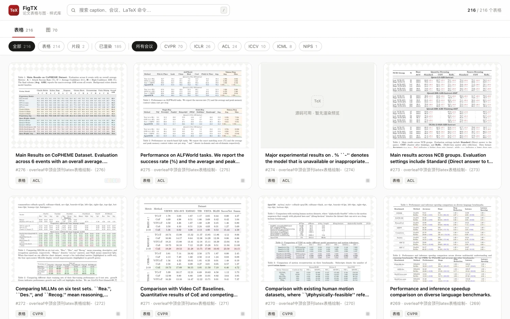</a></p>

- **表格 216 个，185 个已用 tectonic 重新编译出真实渲染图。** 不是截图，是把源码跑一遍得到的干净结果。
- **图 70 个，分四类：框架图 12、动机图 8、实验定量 10、实验定性 8。** 另含 10 张按真实论文逐项复刻的图。
- **一个桌面 app 走完全程。** macOS / Windows / Linux 原生包，或直接用网页版，全部离线可用。

---

## 它能做什么

### 表格：复制走就能用，不用再对像素

三线表、分组表头、整行底色、最优值高亮、跨行合并、全页宽表——216 个从公开论文里挑出来的 LaTeX 表格。
每个都带**真实渲染图**（源码跑一遍的结果，不是截图）、**完整源码**、**配色板**和**会议标签**（CVPR 70 / ICLR 26 / ACL 24 …）。

<p align="center"><a href="docs/assets/shot-detail.webp">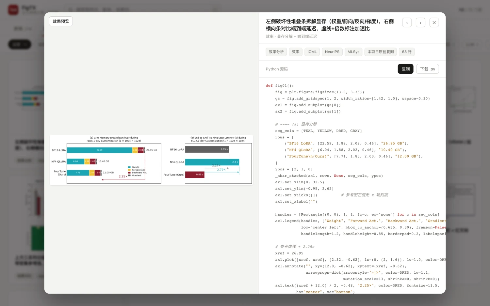</a></p>

### 图：框架图、动机图、实验图，分开找

| 类型 | 数量 | 用来解决什么 |
|---|---|---|
| 框架图 | 12 | 画方法总览：单流 Pipeline / 双分支 / 编码-解码 / 模块放大 / MoE / 量化 / 剪枝 / 蒸馏 / 脉动阵列 |
| 动机图 | 8 | 说清"问题在哪"：差距柱状 / 失败案例 / 精度-代价散点 / 注意力对比 / 频率分布 |
| 实验·定量 | 10 | 收敛、消融、误差带、雷达、热力图、小提琴、帕累托前沿、断轴 |
| 实验·定性 | 8 | 检测框网格、分割掩码、注意力热图、检索 Top-K、失败案例 |
| 绘图样式 | 24 | SciencePlots 16 种期刊配色 + 8 个成图配方 |

<p align="center"><a href="docs/assets/shot-figs.webp">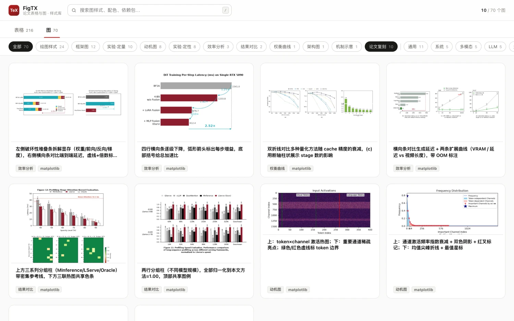</a></p>

### 论文图复刻：照着真图逐项对着画

选 10 张代表性论文图，一像素一像素地复刻：布局、配色、标注位置、箭头弧度、断轴符号。
每张都附**完整可运行代码**，改数据就能用。下面每张图**上方是原图，下方是复刻**：

| 图 | 复刻结果 |
|---|---|
| **效率 · 显存分解**<br>破坏性堆叠条 + 虚线倍数标注 | <a href="docs/assets/replicas/01-memory-latency.webp">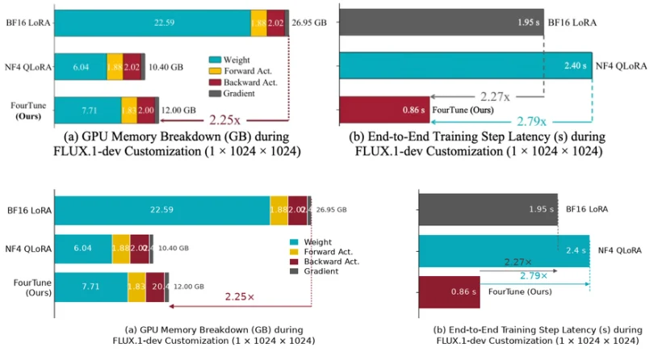</a> |
| **效率 · 逐项融合增益**<br>外弧箭头标每步增益 | <a href="docs/assets/replicas/02-fusion-gain.webp">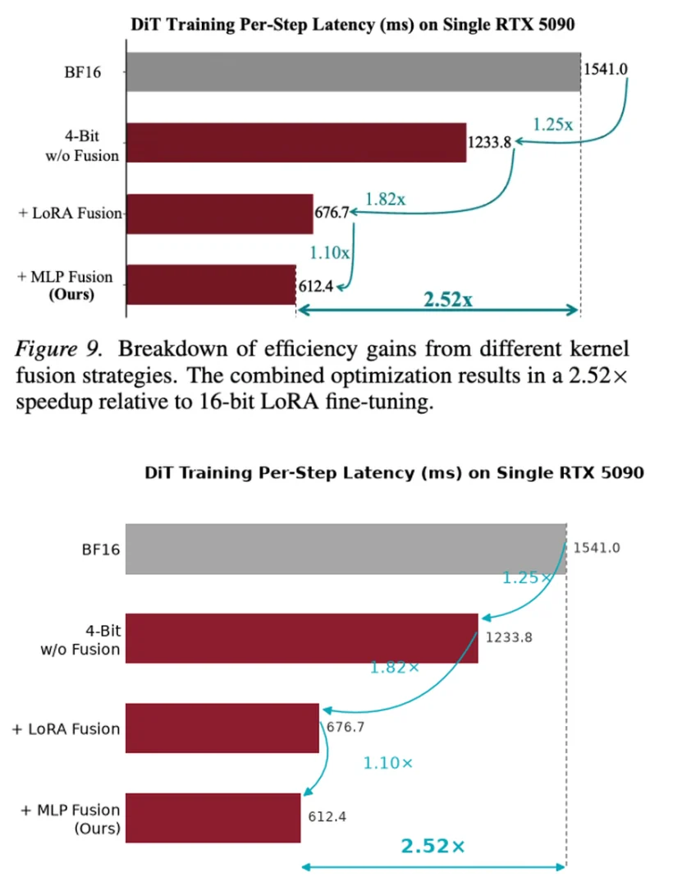</a> |
| **权衡 · 精度曲线**<br>6 系列 + 断轴柱状 | <a href="docs/assets/replicas/03-accuracy-tradeoff.webp">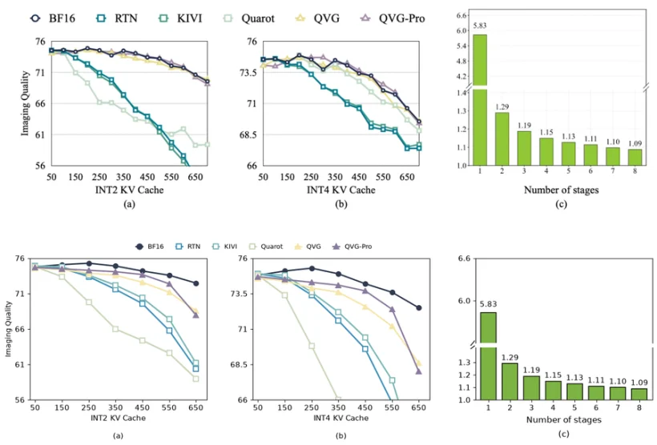</a> |
| **架构 · 流程与模块放大**<br>三面板 TikZ | <a href="docs/assets/replicas/05-architecture.webp">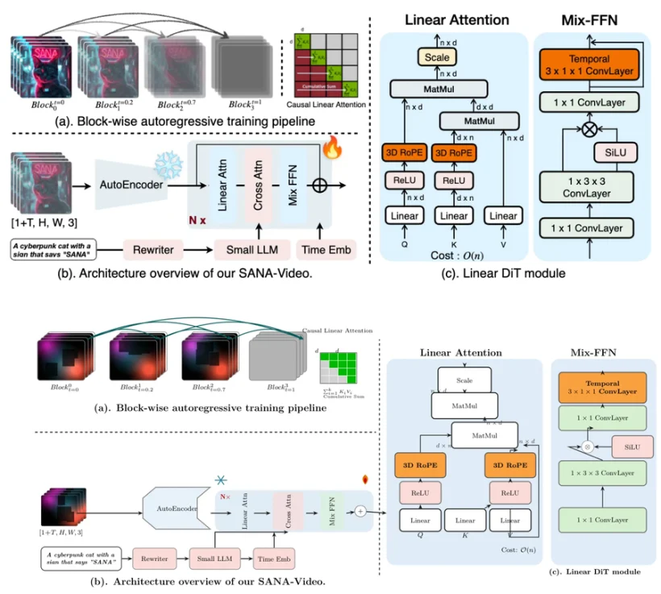</a> |
| **机制 · 张量结构**<br>矩阵格子对比 | <a href="docs/assets/replicas/06-mechanism.webp">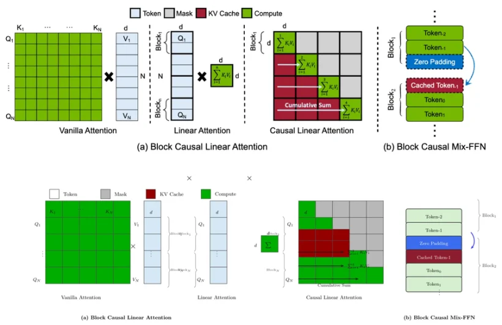</a> |
| **结果 · 分组柱 + 热图**<br>密集参考线 + 三联热图 | <a href="docs/assets/replicas/07-grouped-heatmap.webp">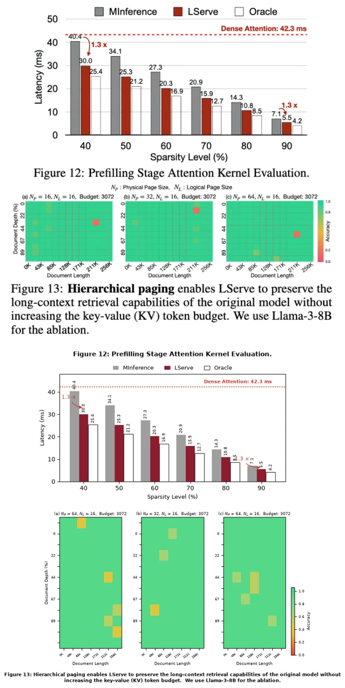</a> |

<details>
<summary>看全部 10 张复刻</summary>

| # | 图 |
|---|---|
| 04 | <a href="docs/assets/replicas/04-latency-scaling.webp">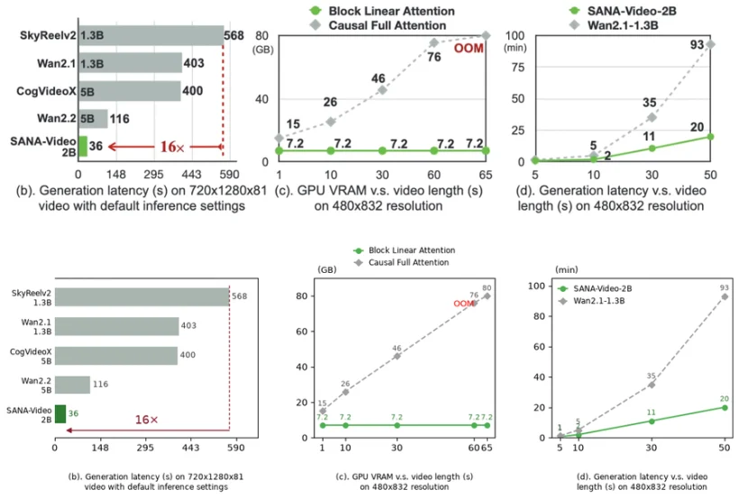</a> |
| 08 | <a href="docs/assets/replicas/08-shared-legend.webp">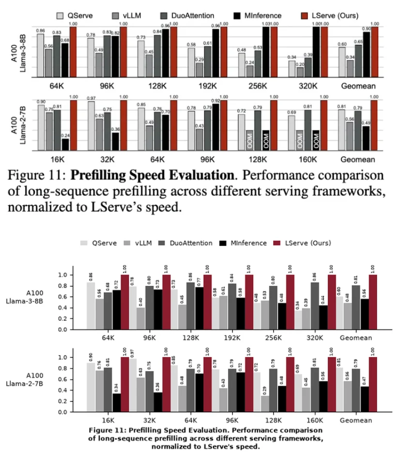</a> |
| 09 | <a href="docs/assets/replicas/09-activation-heatmap.webp">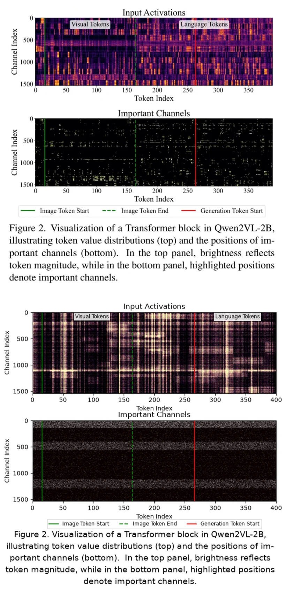</a> |
| 10 | <a href="docs/assets/replicas/10-frequency-outlier.webp">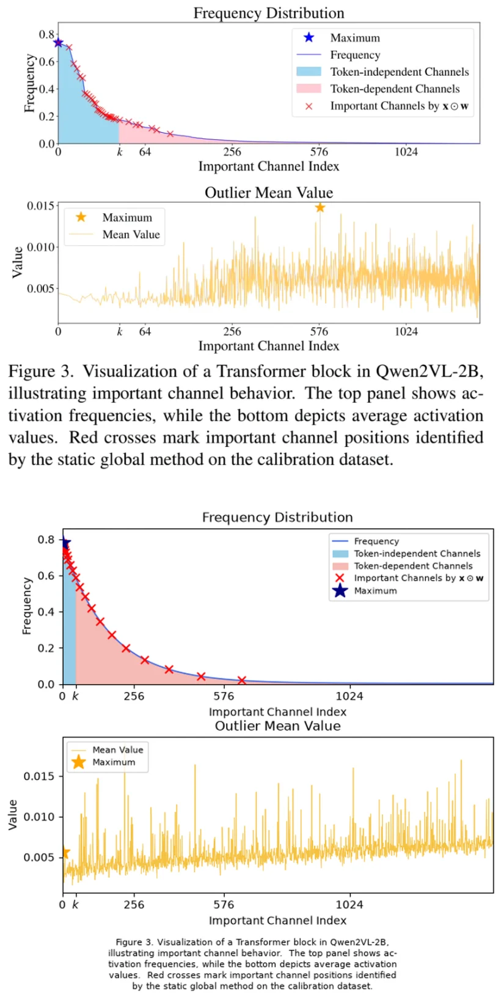</a> |

</details>

---

## 快速开始

### 方式一：桌面版（推荐，离线可用）

到 [Releases](https://github.com/ZhipingWoods/FigTX/releases) 下载对应平台：

| 平台 | 文件 |
|---|---|
| macOS（Apple Silicon） | `FigTX-<version>-arm64.dmg` |
| macOS（Intel） | `FigTX-<version>-x64.dmg` |
| Windows | `FigTX-Setup-<version>-x64.exe` |
| Linux | `FigTX-<version>-x86_64.AppImage` / `.deb` |

### 方式二：网页版

打开 **https://zhipingwoods.github.io/FigTX/** —— 无需安装，换电脑也能用。

### 方式三：本地开发

```bash
git clone git@github.com:ZhipingWoods/FigTX.git
cd FigTX
npm install

npm run dev            # 浏览器 http://localhost:5173
npm run electron:dev   # 桌面窗口
```

打包：

```bash
npm run dist:mac       # .dmg + .zip
npm run dist:win       # NSIS 安装包
npm run dist:linux     # AppImage + deb
```

---

## 更新图表库

数据是纯文本 + 图片，改完跑两条命令就生效：

```bash
# 1. 表格：从 docx 抽 LaTeX
python3 tools/extract_docx.py --docx-dir <docx目录> --notes <notes.json> --out .
python3 tools/render_tex.py --items data/raw-items.json --out public/renders

# 2. 图：模板生成 / 论文图复刻
.venv-fig/bin/python tools/figlab/build.py          # 框架/动机/定量/定性
.venv-fig/bin/python tools/figlab/build_replicas.py # 论文图复刻

# 3. 汇总
node tools/build-data.mjs
```

| 脚本 | 作用 |
|---|---|
| `tools/extract_docx.py` | docx → LaTeX，识别表格/图、抽配色 |
| `tools/render_tex.py` | tectonic 编译 + 自动修复片段 + 转 WebP |
| `tools/figlab/` | 框架图/动机图/定量/定性 模板（TikZ + matplotlib） |
| `tools/figlab/replicas.py` | 论文图复刻（照原图逐项对齐） |
| `tools/build-data.mjs` | 汇总成 `src/data/items.json` |
| `tools/audit.py` | 质量审计：渲染图墨迹占比、边界、源码配平 |

---

## 项目结构

```
FigTX/
├── src/                      React 前端（Vite）
│   ├── App.tsx               表格 / 图 两个分区 + 多层筛选
│   └── data/items.json       构建产物，勿手改
├── electron/                 桌面端外壳（自定义 app:// 协议）
├── tools/                    数据管线
├── data/                     raw-*.json + LaTeX 源码
├── public/renders/           表格渲染图
├── public/renders-fig/       图预览
├── docs/wiki/                Wiki 源文件
└── .github/workflows/        Pages + 三平台 Release
```

---

## 数据来源与致谢

FigTX 站在这些项目的肩膀上：

- **[SciencePlots](https://github.com/garrettj403/SciencePlots)**（MIT）：16 种期刊绘图样式
- **[paper-plot-skills](https://github.com/Trae1ounG/paper-plot-skills)**：8 个成图配方与绘图规范
- **[tectonic](https://tectonic-typesetting.github.io/)**：把 LaTeX 片段编译成真实渲染图
- 表格样式来自公开分享的论文 LaTeX 片段，仅做收集、索引与展示

单个样式的版权归原作者 / 原论文。代码以 [Apache-2.0](LICENSE) 发布。

## License

[Apache-2.0](LICENSE)
